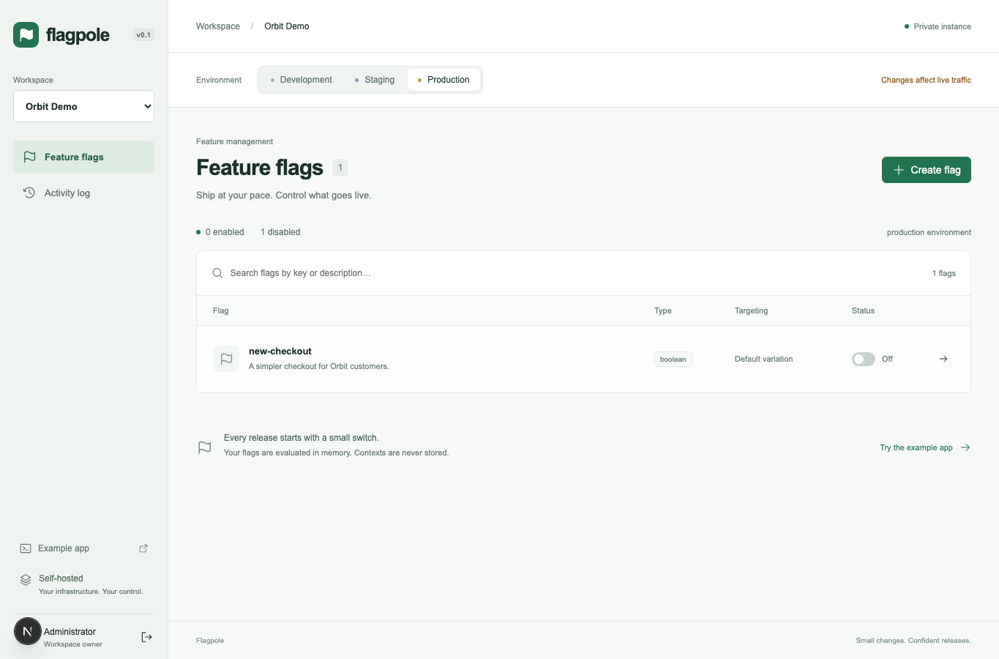

# Flagpole

Self-hosted feature flags for small teams and side projects. Ship gradually, target a plan or app version, and turn a feature off without redeploying your application.



## Status

Phase 1 is implemented. This repository includes the evaluator, PostgreSQL schema and migrations, authenticated admin API, SDK endpoints, JavaScript and React SDKs, admin dashboard, example app, and automated tests. Packages are private workspace packages and have **not** been published.

The project brief is preserved in [docs/SPEC.md](docs/SPEC.md). Future work is in [ROADMAP.md](ROADMAP.md), with issue-ready scope and acceptance criteria in [docs/ISSUES.md](docs/ISSUES.md). Those items are not implemented in Phase 1.

## Privacy

Evaluation contexts contain an opaque `key` and non-identifying attributes such as `plan`, `country`, or `appVersion`.

**Never send emails, names, or personal/customer data as keys or attributes.** Use a random opaque identifier. Contexts are evaluated in memory, never written to PostgreSQL, and never included in application logs or audit entries. The SDK keeps values in memory; it does not use localStorage or cookies. The browser context tester runs entirely in your browser.

If you add infrastructure logging or monitoring, keep evaluation request bodies out of those systems too. All repository sample data is made up.

## Stack and layout

Node.js 24 LTS, pnpm 10, strict TypeScript, NestJS 11, Next.js 16 App Router, React 19, PostgreSQL 17, Prisma 6, and Zod. Redis is not required.

```text
apps/api/             NestJS admin and SDK endpoints; Prisma schema, migrations, seed
apps/web/             Next.js admin dashboard
packages/shared/      Zod contracts and TypeScript types
packages/evaluator/   Pure evaluation engine and MurmurHash3 implementation
packages/sdk-js/      Fetch, in-memory cache, subscriptions, polling
packages/sdk-react/   Provider and hooks, including SSR initial flags
examples/react-app/   Orbit demo store
scripts/              Environment-preserving command runner and password hashing
```

## Run locally

Prerequisites: Node.js **24**, pnpm **10.32.1**, and Docker with Compose. Use your Node version manager to select the version in `.node-version`. The instructions below use a POSIX shell.

### 1. Install and configure

```sh
pnpm install --frozen-lockfile
cp .env.example .env
pnpm db:generate
```

Edit `.env`:

- Set `POSTGRES_PASSWORD` to a new random password. Use the same password in `DATABASE_URL`. The bundled database is bound to `127.0.0.1:54329` to avoid a common local PostgreSQL port conflict.
- Set `SESSION_SECRET` to at least 32 random characters. `openssl rand -hex 32` can generate one.
- Set `ADMIN_PASSWORD_HASH` to the output of the password helper below. It uses scrypt with a random salt; do not put a plaintext password in this field.
- Keep `ADMIN_ORIGIN=http://localhost:3000`, `API_URL=http://localhost:4000`, and `PORT=4000` for the default local setup.

Generate your admin password hash without placing the password in command arguments or shell history:

```sh
read -s FLAGPOLE_ADMIN_PASSWORD
printf '%s' "$FLAGPOLE_ADMIN_PASSWORD" | pnpm exec tsx scripts/hash-password.ts
unset FLAGPOLE_ADMIN_PASSWORD
```

Paste the resulting `scrypt:...` value into `ADMIN_PASSWORD_HASH`. `.env` and other `.env*` files are ignored by Git, except `.env.example`. Keep them private.

### 2. Start PostgreSQL and create the demo

```sh
docker compose up -d --wait
pnpm db:migrate
pnpm db:seed
pnpm build
```

The seed creates **Orbit Demo** (`demo`), three environments (`development`, `staging`, `production`), and two boolean flags (`new-checkout`, `beta-search`). Development configs start enabled but serve `false`; staging and production start disabled.

**SDK keys are printed only when the environments are first created.** Save the output securely. Only SHA-256 hashes are stored in the database. Running the seed again does not duplicate data or print the existing keys. A lost key cannot be recovered from its hash.

### 3. Launch the applications

Run each in a separate terminal at the repository root:

```sh
pnpm dev:api
pnpm dev:web
pnpm dev:example
```

- Dashboard: [localhost:3000](http://localhost:3000), using your admin password.
- API health: [localhost:4000/health](http://localhost:4000/health).
- React example: [localhost:3001](http://localhost:3001). Paste the **development client SDK key** into the example's key field.

The dashboard proxies `/api` to `API_URL`. `ADMIN_ORIGIN` must be the exact browser origin, without a trailing slash. The example uses `http://localhost:4000` by default; to override it, put `VITE_FLAGPOLE_API_URL` in `examples/react-app/.env.local`. That file can also contain `VITE_FLAGPOLE_CLIENT_KEY` for local convenience. Never put a server SDK key in a `VITE_` or `NEXT_PUBLIC_` variable.

To watch changes to a shared package, run `pnpm --filter @flagpole/<package> exec tsc --watch` in another terminal; apps consume its built `dist` files.

Stop application terminals with Ctrl-C. `docker compose down` stops PostgreSQL and preserves its volume. Do not remove the volume unless you intend to delete your local data.

## Try a gradual release

1. Open `new-checkout` in the **development** environment.
2. Add a rule: attribute `plan`, operator `in`, values `["pro"]`, serve `true`.
3. Set the default rule to serve `false` and leave the flag enabled.
4. Use **Test a context** with `{ "key": "demo-visitor", "plan": "pro" }`. The result should show `RULE_MATCH` and the rule ID.
5. Select **Review changes**, inspect the before/after preview, and save.
6. Change the example app's plan from Free to Pro. Its checkout changes. Changes saved in the dashboard also arrive on the example's next poll (every two seconds).
7. Switch the default rule to **Percentage rollout** to try weighted variation assignment. The preview displays percentages to two decimal places; weights must total 100%.

Production toggles require confirmation. Targeting saves include the version originally loaded; a conflicting save returns `409 STALE_FLAG_VERSION`. The dashboard keeps the unsaved draft and offers **Reload latest**; reloading discards that draft. Variations and descriptions have a separate review and save because they apply to every environment.

Archived flags disappear from SDK responses. After the next successful refresh, `useFlag` returns its caller-provided default. Audit history remains accessible.

## React SDK

The SDKs are usable as workspace dependencies. npm publishing is deferred.

```tsx
import { FlagpoleProvider, useFlag } from '@flagpole/sdk-react';

function Checkout() {
  const enabled = useFlag('new-checkout', false);
  return enabled ? <NewCheckout /> : <ClassicCheckout />;
}

export function App() {
  return (
    <FlagpoleProvider
      clientKey="your-environment-client-key"
      apiUrl="http://localhost:4000"
      context={{ key: 'opaque-visitor-id', plan: 'pro' }}
      pollInterval={30_000}
    >
      <Checkout />
    </FlagpoleProvider>
  );
}
```

- `useFlag(key, defaultValue)` returns a boolean or string matching the default's type. It returns the default before loading, for missing flags, on a type mismatch, or outside a provider. The hook never throws.
- `useFlags()` returns the current map of flag values.
- `useFlagpoleStatus()` returns `{ loaded, error }`.
- Fetches on mount and context changes; polls every 30 seconds by default. `pollInterval={0}` disables polling.
- Failed or malformed responses retain the last values. Requests time out after ten seconds by default (`requestTimeout` is configurable).
- Changing context clears the previous identity's values until a new evaluation succeeds. Late responses are ignored; disposal cancels requests and timers.
- For SSR, pass `initialFlags={{ 'new-checkout': true }}` from that request's server evaluation. Use the same initial values for server render and hydration. Fetching starts only after mount. Never share per-context snapshots between requests.
- In Next.js, put the provider in a Client Component. The package preserves its `'use client'` directive.

The framework-independent client exposes the same behavior:

```ts
import { FlagpoleClient } from '@flagpole/sdk-js';

const client = new FlagpoleClient({
  apiUrl: 'http://localhost:4000',
  clientKey: 'your-environment-client-key',
  context: { key: 'opaque-visitor-id' },
});
const unsubscribe = client.subscribe(() => {
  console.log(client.getFlag('new-checkout', false));
});
client.start();
// On application disposal:
unsubscribe();
client.stop();
```

## API contract

Admin routes are under `/api`. Sign in with `POST /api/auth/login` and `{ "password": "..." }`. Admin mutations, including login and logout, require `X-Flagpole-CSRF: 1`. The HttpOnly, SameSite=Strict session cookie expires after eight hours and is Secure when `NODE_ENV=production`. Use HTTPS for that mode. Logout clears the browser cookie; rotating `SESSION_SECRET` invalidates all signed sessions.

| Method      | Route                                                 | Purpose                                            |
| ----------- | ----------------------------------------------------- | -------------------------------------------------- |
| GET         | `/api/projects`                                       | Projects and environments, excluding key hashes    |
| GET / POST  | `/api/projects/:slug/flags`                           | List / create                                      |
| GET / PATCH | `/api/projects/:slug/flags/:key`                      | Detail / edit description and variations           |
| PUT         | `/api/projects/:slug/flags/:key/environments/:env`    | Replace config with `expectedVersion`              |
| POST        | `/api/projects/:slug/flags/:key/archive`              | Archive in all environments                        |
| GET         | `/api/projects/:slug/audit?flag=&env=&limit=&cursor=` | Audit with filters and cursor pagination           |
| GET / POST  | `/api/auth/session` / `/api/auth/logout`              | Session state / sign out                           |
| POST        | `/sdk/v1/evaluate`                                    | Evaluate with a **client** SDK key                 |
| GET         | `/sdk/v1/flags`                                       | Raw definitions with a **server** SDK key and ETag |
| GET         | `/health`                                             | Liveness                                           |

SDK routes require `Authorization: Bearer <sdk-key>`. Client and server keys are distinct and scoped to one environment. The evaluation body is `{ "context": { "key": "opaque-id", "plan": "pro" } }`; the response is `{ "flags": { "flag-key": { "value": true, "variationIndex": 1, "reason": "RULE_MATCH", "ruleId": "..." } } }`.

`GET /sdk/v1/flags` returns `{ "flags": [{ "flag": { ... }, "config": { ... } }] }`. Send the returned ETag in `If-None-Match` to receive `304` when unchanged. A server SDK that consumes these definitions is a roadmap item.

SDK CORS checks `Environment.allowedOrigins` for the authenticated environment. The seed allows `http://localhost:3001`. For another browser origin, an operator must update that environment's `allowedOrigins` in PostgreSQL. A preflight can only check whether an origin is configured; the actual authenticated request rechecks the origin against its specific environment. Non-browser callers without an Origin header still require an SDK key.

Errors use `{ code, message }`, including `FLAG_KEY_TAKEN`, `INVALID_ROLLOUT_WEIGHTS`, `STALE_FLAG_VERSION`, and `SDK_KEY_INVALID`. Config mutations lock the flag row and check the expected version inside the same transaction that appends the audit entry. Metadata changes increment all associated config versions. A PostgreSQL trigger rejects updates and deletes to existing audit entries.

## Evaluation behavior

The evaluator has no I/O. Missing/archived flags or missing configs return `FLAG_NOT_FOUND`; invalid config references return `INVALID_CONFIG`. Disabled configs serve the off variation. Otherwise, the first rule whose clauses all match wins; if none match, the fallthrough is served.

Supported operators: `in`, `not_in`, `starts_with`, `ends_with`, `contains`, `semver_gte`, `semver_lt`. Missing attributes never match, including `not_in`. Equality is type-sensitive. Text operators require strings; semver comparisons require valid semantic versions and support prereleases. Values within a clause are alternatives; clauses within a rule are ANDed.

Rollout weights are integer basis points summing to 10,000. Bucketing uses unsigned MurmurHash3 x86-32, seed zero, over UTF-8 `flagKey + "." + salt + "." + context.key`, modulo 10,000. Config salt is assigned at creation and cannot be changed through the API. Keeping bucket order and salt stable makes a two-way weight increase expand the first bucket without removing its existing contexts. Reordering buckets changes assignments.

## Test and verify

PostgreSQL must be running and `DATABASE_URL` set in `.env` or the process environment. Tests create and remove **random isolated schemas**, not your existing demo tables. The database role needs schema-creation privileges for tests and migrations.

```sh
pnpm db:generate
pnpm build               # bootstrap workspace exports on a fresh checkout
pnpm check               # lint + formatting + strict types + tests + all builds
pnpm test:integration    # PostgreSQL API tests only
pnpm exec playwright install chromium
pnpm test:e2e
```

`pnpm test:e2e` starts its own API, dashboard, and example on ports **4100, 3100, 3101**. Those ports must be free. It generates ephemeral passwords and keys, migrates an isolated schema, runs Chromium, then stops its servers and drops its schema. Build first after changing compiled API/shared/SDK code. Reports and traces are local ignored files in `playwright-report/` and `test-results/`; traces may contain ephemeral test credentials.

Verified coverage includes:

- 23 evaluator tests, including a reproducible 100,000-key distribution property within ±1 percentage point and monotonic two-way rollout expansion.
- 10 real PostgreSQL API tests for authentication, version races, transaction rollback when audit fails, immutable audit, pagination, key roles, environment isolation, CORS, privacy, and ETags.
- 8 SDK tests using MSW and React Testing Library, including polling, request cancellation, error retention, SSR, and React StrictMode.
- 2 Playwright scenarios for dashboard → API → React behavior and stale edits between browser tabs. Desktop and mobile layout checks are included.

CI runs the same quality gates with PostgreSQL, then Playwright. `pnpm format` applies repository formatting. Vite may report that it ignores the React package's `'use client'` directive; that directive is relevant to Next.js, and the client-only Vite build succeeds.

## Phase 1 boundaries

One admin identity (`admin` in the audit log), boolean/string flags, ordered clauses, percentage rollouts, and polling. The seed provisions the demo project and environments; project/environment management and SDK key rotation do not have dashboard flows. There is no context history, evaluation analytics, Redis, package publication, streaming, roles, or scheduled changes. Production confirmation is a dashboard interaction, not a server-side approval workflow.

The Compose file starts PostgreSQL only. Container images and a deployment guide are deliberately deferred. The remaining planned work is specified in [ROADMAP.md](ROADMAP.md).

## License

[MIT](LICENSE), Copyright (c) 2026 fernandaquerino.
